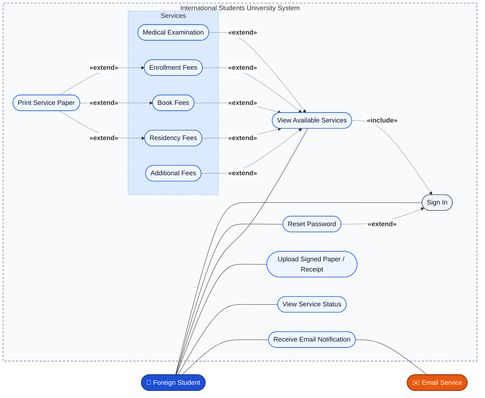
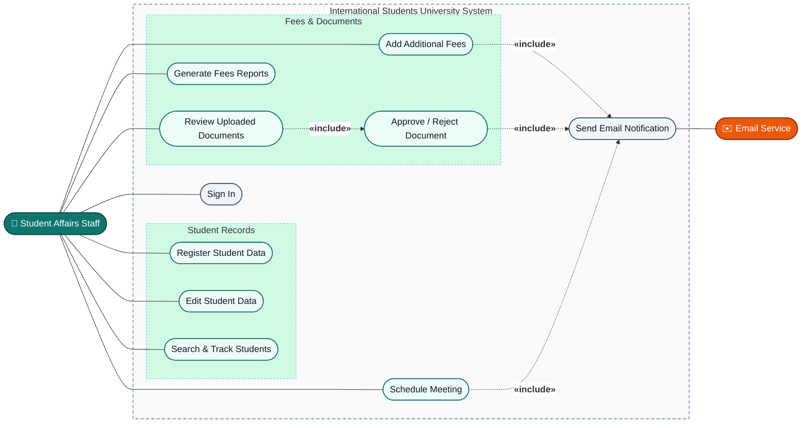
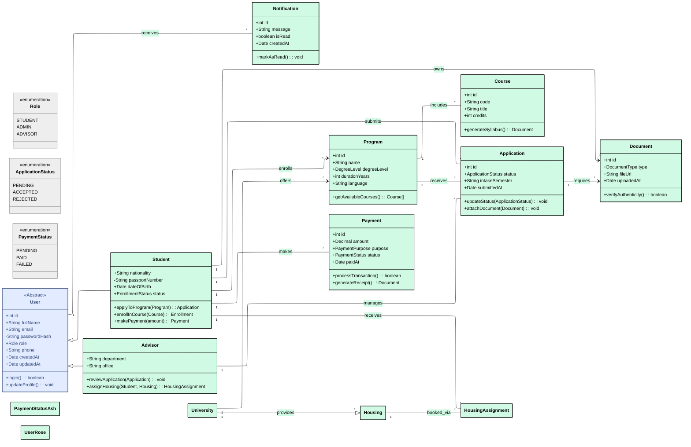
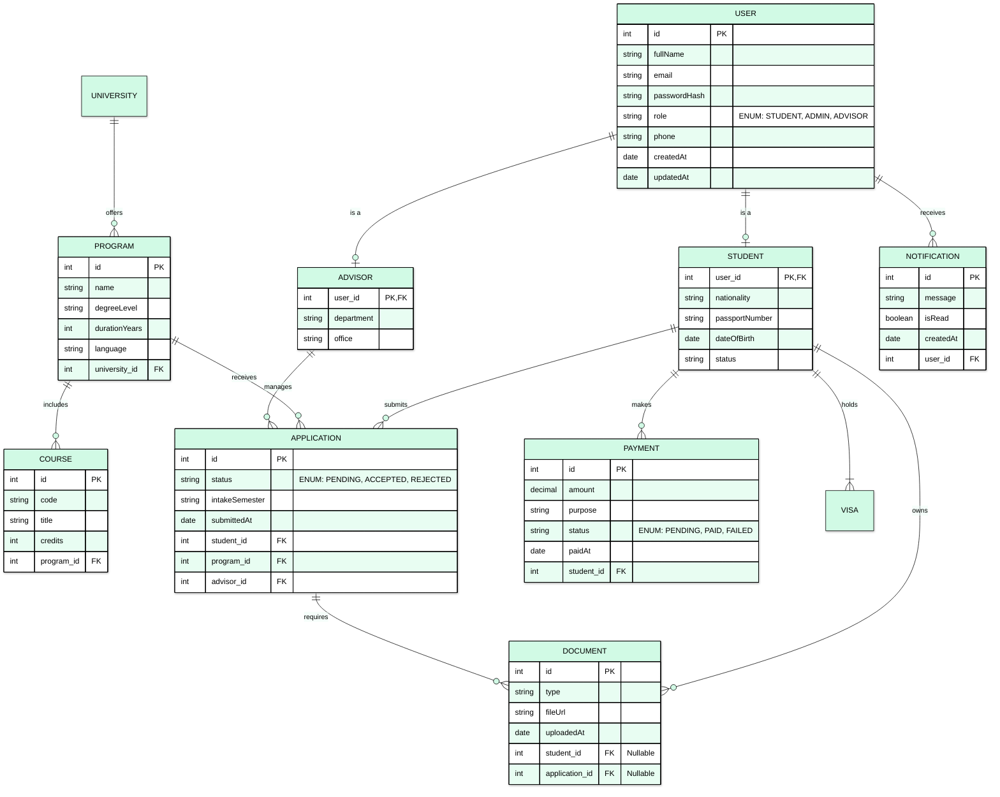

# International Students University System

## Overview

A website that lets international (foreign) students complete their university services online, while Student Affairs staff manage student data, fees, and documents.

## System Flow

1. Students come to the faculty to register.
2. Student data is uploaded on the system (by the staff).
3. Students sign in on the system.
4. The website shows buttons for the different services the student can use.
5. Students choose the service.
6. The system shows the service.
7. The student prints the paper.
8. The student signs the papers.
9. The student uploads the signed papers (payment receipt) to the system.

## Services

1. Medical Examination
2. Enrollment Fees
3. Book Fees
4. Residency Fees
5. Additional Fees that should be paid
6. Notification for any meeting with the staff (via Email)

## Users

- Foreign Students
- Student Affairs

## User Stories

### Foreign Student

**User Story 1**
As a `<Student>`
I want to `<sign in on the system with my account>`
So that `<I can securely access my own services>`

**User Story 2**
As a `<Student>`
I want to `<see buttons for all the available services after signing in>`
So that `<I can easily choose the service I need>`

**User Story 3**
As a `<Student>`
I want to `<choose the Medical Examination service and view its details>`
So that `<I know what is required and can complete it>`

**User Story 4**
As a `<Student>`
I want to `<view and print the Enrollment Fees paper>`
So that `<I can pay the fees and sign the paper>`

**User Story 5**
As a `<Student>`
I want to `<view and print the Book Fees paper>`
So that `<I can pay for my books on time>`

**User Story 6**
As a `<Student>`
I want to `<view and print the Residency Fees paper>`
So that `<I can keep my residency status valid>`

**User Story 7**
As a `<Student>`
I want to `<see any additional fees that should be paid>`
So that `<I don't miss any payment>`

**User Story 8**
As a `<Student>`
I want to `<upload the signed papers (payment receipt) to the system>`
So that `<the faculty can confirm that I completed the service>`

**User Story 9**
As a `<Student>`
I want to `<receive an email notification about any meeting with the staff>`
So that `<I don't miss important appointments>`

**User Story 10**
As a `<Student>`
I want to `<see the status of each service (pending, completed, rejected)>`
So that `<I know what I still need to do>`

### Student Affairs (Staff)

**User Story 11**
As a `<Staff member>`
I want to `<upload the student's data to the system after the student registers at the faculty>`
So that `<the student can sign in and use the services>`

**User Story 12**
As a `<Staff member>`
I want to `<edit or update a student's data>`
So that `<the information stays correct>`

**User Story 13**
As a `<Staff member>`
I want to `<add additional fees to a specific student>`
So that `<the student is informed and can pay them>`

**User Story 14**
As a `<Staff member>`
I want to `<review the signed papers and receipts uploaded by students>`
So that `<I can verify and approve the payments>`

**User Story 15**
As a `<Staff member>`
I want to `<schedule a meeting and send an email notification to the student>`
So that `<the student is informed automatically>`

**User Story 16**
As a `<Staff member>`
I want to `<search for students and track the status of their services>`
So that `<I can follow up with students who haven't completed their services>`

## Functional Requirements

### Authentication and Account Management

- **FR1:** The system shall allow Student Affairs staff to upload and register student data.
- **FR2:** The system shall allow registered students to sign in with a username and password.
- **FR3:** The system shall allow students to reset their password.
- **FR4:** The system shall restrict each user to the features of their role (Student or Student Affairs).

### Services

- **FR5:** The system shall display a button for each available service after the student signs in.
- **FR6:** The system shall show the details of the selected service (Medical Examination, Enrollment Fees, Book Fees, Residency Fees, Additional Fees).
- **FR7:** The system shall generate a printable version of each service form or payment paper.
- **FR8:** The system shall allow students to upload the signed papers or payment receipt (PDF or image).
- **FR9:** The system shall track and display each service's status (Not started, Pending review, Completed, Rejected).

### Staff Functions

- **FR10:** The system shall allow staff to add, edit, and search student records.
- **FR11:** The system shall allow staff to add additional fees to a student's account.
- **FR12:** The system shall allow staff to view, approve, or reject uploaded documents and receipts.
- **FR13:** The system shall allow staff to schedule meetings with students.

### Notifications

- **FR14:** The system shall send an email notification to the student for any meeting with the staff.
- **FR15:** The system shall notify the student when new additional fees are added or when an uploaded document is approved or rejected.

### Language and Reporting

- **FR16:** The system shall support English (and optionally Arabic) for the interface.
- **FR17:** The system shall allow staff to generate reports of paid and unpaid fees per student.

## Non-Functional Requirements

| Category | Requirement |
|----------|-------------|
| **Security** | Passwords must be stored encrypted (hashed). All data is transferred over HTTPS. Role-based access control must be enforced. Sessions expire after inactivity. |
| **Privacy** | Students' personal data (passport, medical, payment) must be accessible only to the student and authorized staff. |
| **Availability** | The system should be available 99% of the time, especially during registration periods. |
| **Usability** | The interface must be simple and clear for non-native speakers, with large service buttons and minimal steps. |
| **Maintainability** | The code should be modular so that new services can be added without changing the whole system. |
| **Email Delivery** | Email notifications should be sent within 1 minute of the triggering event. |

# International Students University System – Use Case Diagram

## Actors

- **Foreign Student** (primary): signs in, views and prints service papers, uploads signed papers/receipts, tracks status.
- **Student Affairs Staff** (primary): manages student data and fees, reviews documents, schedules meetings, generates reports.
- **Email Service** (secondary): delivers email notifications to students.

## 1. Student Use Cases

## 2. Staff Use Cases

## 3. Use Case Scenarios

### Common

**Use Case Scenario 1: Sign In**

- **Actor:** `<Student>`, `<Staff member>`
- **Precondition:** `<The account has been registered by Student Affairs>`
- **Main Flow:**
  1. The user opens the website and enters a username and password.
  2. The system validates the credentials.
  3. The system opens the home page for the user's role.
- **Alternative Flows:**
  - 2a. Wrong credentials: the system shows an error message and the user tries again.
  - 2b. Forgot password: the user selects *Reset Password*.
  - 3a. Session expires after inactivity: the system signs the user out.
- **Postcondition:** `<The user is signed in and sees only the features of their role>`

### Foreign Student

**Use Case Scenario 2: Reset Password**

- **Actor:** `<Student>`
- **Precondition:** `<The student has a registered account with an email address>`
- **Main Flow:**
  1. The student selects *Forgot Password* on the sign-in page.
  2. The student enters their registered email.
  3. The system sends a reset link by email.
  4. The student opens the link and enters a new password.
  5. The system saves the new password (hashed) and confirms the change.
- **Alternative Flows:**
  - 2a. Email not registered: the system shows a message and sends nothing.
  - 4a. Link expired: the system asks the student to request a new one.
- **Postcondition:** `<The password is changed>`

**Use Case Scenario 3: View Service and Print Paper**

- **Actor:** `<Student>`
- **Precondition:** `<The student is signed in>`
- **Main Flow:**
  1. The system displays a button for each available service.
  2. The student selects a service (Medical Examination, Enrollment Fees, Book Fees, or Residency Fees).
  3. The system shows the service details and the amount due.
  4. The student selects *Print*.
  5. The system generates a printable version of the paper.
  6. The student prints the paper.
- **Alternative Flows:**
  - 2a. The student selects *Additional Fees*: the system shows the fees added by staff, or a message that there are none.
  - 5a. Generating the paper fails: the system shows an error and the student retries.
- **Postcondition:** `<The student has a printed paper ready to be paid and signed>`

**Use Case Scenario 4: Upload Signed Paper / Receipt**

- **Actor:** `<Student>`
- **Precondition:** `<The student has printed the paper, paid the fees, and signed it>`
- **Main Flow:**
  1. The student opens the service and selects *Upload*.
  2. The student chooses the signed paper or receipt (PDF or image).
  3. The system checks the file type.
  4. The system saves the file and sets the service status to *Pending review*.
  5. The system confirms the upload.
- **Alternative Flows:**
  - 3a. File type not allowed: the system rejects the file and asks for a PDF or image.
  - 4a. Upload fails: the system shows an error and the student retries.
- **Postcondition:** `<The document is saved and the service status is Pending review>`

**Use Case Scenario 5: View Service Status**

- **Actor:** `<Student>`
- **Precondition:** `<The student is signed in>`
- **Main Flow:**
  1. The student opens the services page.
  2. The system shows each service with its status: *Not started*, *Pending review*, *Completed*, or *Rejected*.
  3. The student selects a service to see more details.
- **Alternative Flows:**
  - 3a. Service is *Rejected*: the system shows the staff's reason and lets the student upload the document again.
- **Postcondition:** `<The student knows what remains to be done>`

### Student Affairs (Staff)

**Use Case Scenario 6: Register Student Data**

- **Actor:** `<Staff member>`
- **Precondition:** `<The staff member is signed in and the student has registered at the faculty>`
- **Main Flow:**
  1. The staff member selects *Add Student*.
  2. The staff member enters or uploads the student's data.
  3. The system validates the data.
  4. The system creates the account and saves the record.
  5. The system confirms that the student is registered.
- **Alternative Flows:**
  - 3a. Required data missing or invalid: the system highlights the problem and the staff member corrects it.
  - 3b. Student already exists: the system warns the staff member and does not create a duplicate.
- **Postcondition:** `<The student account exists and the student can sign in>`

**Use Case Scenario 7: Add Additional Fees**

- **Actor:** `<Staff member>`, `<Email Service>`
- **Precondition:** `<The staff member is signed in and the student record exists>`
- **Main Flow:**
  1. The staff member searches for the student and opens the record.
  2. The staff member selects *Add Additional Fee* and enters the fee name and amount.
  3. The system saves the fee under the student's *Additional Fees*.
  4. The system sends an email notification to the student.
- **Alternative Flows:**
  - 2a. Name or amount missing: the system asks the staff member to complete it.
  - 4a. Email cannot be delivered: the system logs the failure and the fee stays visible on the student's account.
- **Postcondition:** `<The fee is added and the student is notified>`

**Use Case Scenario 8: Review and Approve / Reject Document**

- **Actor:** `<Staff member>`, `<Email Service>`
- **Precondition:** `<The staff member is signed in and a student has uploaded a document>`
- **Main Flow:**
  1. The staff member opens the list of documents waiting for review.
  2. The staff member opens a student's uploaded paper or receipt.
  3. The staff member checks the document against the student's fees.
  4. The staff member selects *Approve*.
  5. The system sets the service status to *Completed*.
  6. The system sends an email notification to the student.
- **Alternative Flows:**
  - 4a. Document invalid: the staff member selects *Reject* and enters a reason. The system sets the status to *Rejected* and notifies the student.
- **Postcondition:** `<The document status is updated and the student is notified>`

**Use Case Scenario 9: Schedule Meeting**

- **Actor:** `<Staff member>`, `<Email Service>`
- **Precondition:** `<The staff member is signed in and the student record exists>`
- **Main Flow:**
  1. The staff member opens the student's record and selects *Schedule Meeting*.
  2. The staff member enters the date, time, and purpose.
  3. The system saves the meeting.
  4. The system emails the student the meeting details within 1 minute.
- **Alternative Flows:**
  - 2a. Date is in the past: the system asks the staff member to choose a valid date.
  - 4a. Email cannot be delivered: the system logs the failure and shows a warning to the staff member.
- **Postcondition:** `<The meeting is saved and the student receives an email>`

## 4. UML class diagram

## 4. ERD 

